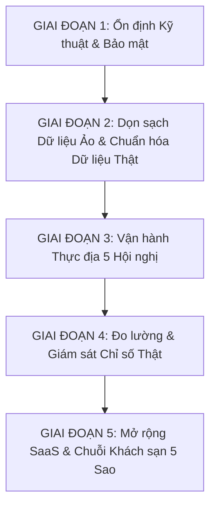

# ONE CONNECT NETWORK — PILOT ROADMAP

> **Lộ trình Kỹ thuật Triển khai Thực tế Cho 5 Hội nghị & 1.500 Thẻ Doanh nhân**  
> **Phiên bản:** v1.0 — Chuẩn hóa Vận hành & Đo lường Thực tế (Zero Mock Data)  
> **Đối tượng áp dụng:** Hội Doanh nhân Trẻ Khánh Hòa & Chuỗi Sự kiện MICE

---

## TỔNG QUAN LỘ TRÌNH 5 GIAI ĐOẠN

---

## GIAI ĐOẠN 1: ỔN ĐỊNH KỸ THUẬT & BẢO MẬT (STAGE 1 — TECHNICAL STABILITY)

Mục tiêu: Đảm bảo nền móng hệ thống không bị lỗi ngầm, không sập khi có lượng truy cập đột biến và phân quyền chuẩn xác ở tầng máy chủ.

### Nhiệm vụ 1.1: Siết chặt Bảo mật Phiên Đăng nhập tại Middleware Máy chủ
* **Tên công việc (Task):** Nâng cấp xác thực phiên làm việc trong `apps/frontend/src/lib/supabase/middleware.ts` bằng `@supabase/ssr`.
* **Lý do (Why):** Hiện tại hệ thống chỉ kiểm tra xem trình duyệt có cookie `one_connect_auth_session` hay không mà chưa kiểm tra chữ ký token JWT từ Supabase. Người ngoài có thể tạo cookie giả để xem màn hình quản trị.
* **Mức độ ưu tiên (Priority):** **P0 (Bắt buộc)**
* **Kết quả kỳ vọng (Expected Result):** Mọi yêu cầu truy cập trang Admin hoặc Quản trị Hiệp hội đều được máy chủ Supabase chứng thực hợp lệ, tự động chuyển về trang Đăng nhập nếu phiên hết hạn.
* **Rủi ro (Risk):** Nếu cấu hình chưa đúng redirect URL, người dùng đang đăng nhập có thể bị văng ra trang đăng nhập một lần (cần kiểm tra kỹ luồng cookie).

### Nhiệm vụ 1.2: Chuẩn hóa Bộ nhớ Đệm & Bẫy Lỗi Toàn cục (Error Boundaries)
* **Tên công việc (Task):** Bổ sung màn hình báo lỗi thân thiện (`error.tsx`) cho từng phân hệ (Check-in, Hồ sơ cá nhân, Ghép nối B2B).
* **Lý do (Why):** Nếu đường truyền mạng hội trường bị chập chờn hoặc cơ sở dữ liệu quá tải tức thời, người dùng không bị nhìn thấy màn hình trắng hoặc mã lỗi kỹ thuật.
* **Mức độ ưu tiên (Priority):** **P1**
* **Kết quả kỳ vọng (Expected Result):** Khi có sự cố, hệ thống hiện thông báo: *"Đang kết nối lại hệ thống, vui lòng thử lại sau vài giây"* kèm nút Thử lại (Retry).
* **Rủi ro (Risk):** Rủi ro rất thấp.

---

## GIAI ĐOẠN 2: DỌN SẠCH DỮ LIỆU ẢO & CHUẨN HÓA DỮ LIỆU THẬT (STAGE 2 — REAL DATA / ZERO MOCK DATA)

Mục tiêu: Loại bỏ 100% dữ liệu mẫu, hồ sơ demo, sản phẩm ảo; xây dựng luồng kích hoạt thẻ thực tế cho đại biểu nhận thẻ NFC tại sự kiện.

### Nhiệm vụ 2.1: Tái cấu trúc Luồng Quét Thẻ Công Khai (`/c/[cardUid]`)
* **Tên công việc (Task):** Xóa bỏ mảng UID cố định và hồ sơ mẫu Johnny Long. Truy vấn trực tiếp từ bảng `access_cards`.
* **Lý do (Why):** Thẻ NFC in ra có mã UID ngẫu nhiên từ nhà máy. Khi chạm vào điện thoại, hệ thống phải tra cứu đúng thẻ đó thuộc về ai. Nếu thẻ chưa ai nhận, phải mở luồng Kích hoạt Thẻ.
* **Mức độ ưu tiên (Priority):** **P0 (Bắt buộc)**
* **Kết quả kỳ vọng (Expected Result):** 
  - Thẻ đã kích hoạt → Mở ngay hồ sơ chính chủ của doanh nhân.
  - Thẻ mới chưa kích hoạt → Mở màn hình *"Chào mừng Doanh nhân! Chạm vào đây để kích hoạt thẻ chính chủ của bạn"*.
* **Rủi ro (Risk):** Cần đảm bảo tốc độ truy vấn từ bảng `access_cards` có chỉ mục để không làm chậm thời gian chạm thẻ.

### Nhiệm vụ 2.2: Dọn sạch Sản phẩm Mẫu trên Hồ sơ Cá nhân (`/p/[card_id]`)
* **Tên công việc (Task):** Gỡ bỏ mảng cài cứng `PRODUCTS` và `JOINED_EVENTS`, kết nối với bảng cơ sở dữ liệu thật hoặc hiển thị Empty State.
* **Lý do (Why):** Hiện tại mọi doanh nhân mở hồ sơ cá nhân lên đều hiển thị cùng một danh sách sản phẩm mẫu (dịch vụ thiết kế web, cà phê mẫu...). Doanh nhân thật nhìn thấy sẽ phản ánh sản phẩm không đúng của họ.
* **Mức độ ưu tiên (Priority):** **P0 (Bắt buộc)**
* **Kết quả kỳ vọng (Expected Result):** Hiển thị đúng sản phẩm/dịch vụ mà doanh nghiệp đã cập nhật trong hồ sơ. Nếu chưa cập nhật, hiển thị nhẹ nhàng: *"Doanh nghiệp đang cập nhật danh mục dịch vụ"*.
* **Rủi ro (Risk):** Cần cập nhật giao diện form chỉnh sửa doanh nghiệp để doanh nhân tự thêm được sản phẩm của mình.

### Nhiệm vụ 2.3: Xóa Dữ liệu Fallback 150 Hội viên tại Trang Quản trị Hiệp hội
* **Tên công việc (Task):** Loại bỏ logic fallback cứng `{ memberCount: 150 }` tại `apps/frontend/src/app/admin/org/page.tsx`.
* **Lý do (Why):** Tuân thủ tuyệt đối nguyên tắc Zero Mock Data. Số lượng hội viên phải đếm từ số dòng thật trong bảng `organization_members`.
* **Mức độ ưu tiên (Priority):** **P1**
* **Kết quả kỳ vọng (Expected Result):** Hiển thị đúng số hội viên thực tế đã đăng ký vào Hội Doanh nhân Trẻ Khánh Hòa.
* **Rủi ro (Risk):** Không có rủi ro kỹ thuật.

---

## GIAI ĐOẠN 3: VẬN HÀNH THỰC ĐỊA 5 HỘI NGHỊ (STAGE 3 — PILOT OPERATIONS)

Mục tiêu: Đảm bảo quy trình cấp phát 1.500 thẻ vật lý và vận hành điểm danh mượt mà tại hội trường không xảy ra sự cố nghẽn.

### Nhiệm vụ 3.1: Công cụ Xuất Danh mục Mã Thẻ cho Nhà In Thẻ Vật lý
* **Tên công việc (Task):** Xây dựng tính năng xuất 1.500 mã QR và đường link chạm NFC chuẩn (ví dụ: `https://oneconnect.id.vn/c/[UID]`) ra file Excel/CSV.
* **Lý do (Why):** Nhà máy sản xuất thẻ cần danh sách link chính xác để ghi vào chip NFC và in mã QR lên mặt sau của 1.500 thẻ vật lý trước ngày hội nghị.
* **Mức độ ưu tiên (Priority):** **P0 (Bắt buộc)**
* **Kết quả kỳ vọng (Expected Result):** Ban tổ chức tải về file danh sách định dạng chuẩn, bàn giao cho đơn vị in thẻ chỉ trong 1 thao tác.
* **Rủi ro (Risk):** Cần bảo mật danh sách UID thẻ, tránh lộ lọt trước khi bàn giao cho hội viên.

### Nhiệm vụ 3.2: Bộ nhớ Đệm Ngoại tuyến cho Bàn Đón tiếp Lễ tân (Offline Check-in Cache)
* **Tên công việc (Task):** Lưu lịch sử quét thẻ tạm thời vào bộ nhớ trình duyệt của máy tính bảng lễ tân (IndexedDB) nếu mất kết nối Internet.
* **Lý do (Why):** Hội trường đông người thường xuyên bị nghẽn sóng 4G/WiFi. Bàn đón tiếp không được phép dừng lại chờ mạng.
* **Mức độ ưu tiên (Priority):** **P1**
* **Kết quả kỳ vọng (Expected Result):** Quét thẻ kêu "Bíp" và báo thành công ngay lập tức; khi có mạng lại, hệ thống tự động đẩy dữ liệu điểm danh về Supabase.
* **Rủi ro (Risk):** Phải xử lý trường hợp một đại biểu chạy qua 2 cửa quét khác nhau trong lúc mất mạng (xử lý trùng lặp khi đồng bộ lại).

### Nhiệm vụ 3.3: Thống nhất Phạm vi Phân hệ 5 (Smart Expo) cho Chuỗi 5 Hội nghị
* **Tên công việc (Task):** Làm rõ với Ban tổ chức xem 5 hội nghị tới có sử dụng gian hàng triển lãm không. Nếu có, triển khai phiên bản tinh gọn (Mini Expo: Quét QR tại bàn doanh nghiệp để lấy thông tin). Nếu không, tạm thời ẩn mục Expo để tập trung 100% vào Thẻ và Check-in.
* **Lý do (Why):** Tránh việc đại biểu bấm vào tính năng chưa hoàn thiện gây trải nghiệm xấu.
* **Mức độ ưu tiên (Priority):** **P0 (Quyết định định hướng)**
* **Kết quả kỳ vọng (Expected Result):** Trải nghiệm người dùng đồng nhất, không có nút bấm "chết".
* **Rủi ro (Risk):** Phụ thuộc vào kịch bản tổ chức của Hội Doanh nhân Trẻ Khánh Hòa.

---

## GIAI ĐOẠN 4: ĐO LƯỜNG & GIÁM SÁT CHỈ SỐ THẬT (STAGE 4 — MEASUREMENT & TELEMETRY)

Mục tiêu: Cung cấp bằng chứng số liệu thời gian thực cho Founder và Ban tổ chức trả lời mọi câu hỏi về hiệu quả của sự kiện.

### Nhiệm vụ 4.1: Bảng Điều khiển Đo lường Chỉ số Thực tế (Pilot Telemetry Dashboard)
* **Tên công việc (Task):** Xây dựng màn hình `/admin/pilot-metrics` hiển thị 8 chỉ số cốt lõi từ dữ liệu thực:
  1. Số thẻ vật lý đã kích hoạt / Tổng 1.500 thẻ.
  2. Số đại biểu đã check-in thành công.
  3. Thời gian phản hồi check-in trung bình (mili-giây).
  4. Số lượt quét thẻ xem danh bạ doanh nhân.
  5. Số yêu cầu kết nối giao thương B2B được tạo.
  6. Số yêu cầu kết nối được 2 bên chấp thuận.
  7. Tỷ lệ phản hồi ghép nối giao thương AI (Hữu ích / Không hữu ích).
  8. Số lượng cơ hội kinh doanh (Leads) phát sinh thực tế.
* **Lý do (Why):** Founder cần những con số chính xác này để báo cáo với Ban chấp hành Hội Doanh nhân Trẻ Khánh Hòa và làm tài liệu bán hàng cho Phase 2.
* **Mức độ ưu tiên (Priority):** **P0 (Bắt buộc)**
* **Kết quả kỳ vọng (Expected Result):** Đồ thị và số liệu nhảy theo thời gian thực (Real-time), không có bất kỳ con số ước lượng hay số ảo nào.
* **Rủi ro (Risk):** Cần tối ưu câu lệnh truy vấn đếm (COUNT) trên PostgreSQL để không làm chậm cơ sở dữ liệu.

---

## GIAI ĐOẠN 5: MỞ RỘNG SAAS & KHÁCH SẠN 5 SAO (STAGE 5 — SCALE PREPARATION)

Mục tiêu: Đóng gói sản phẩm để bán cho các khách sạn 5 sao và các hiệp hội doanh nghiệp trên toàn quốc sau khi hoàn thành 5 hội nghị Pilot.

### Nhiệm vụ 5.1: Phân tách Đa Tổ chức Độc lập (Multi-tenant SaaS Architecture)
* **Tên công việc (Task):** Phân chia không gian dữ liệu độc lập hoàn toàn giữa các Hiệp hội và các Khách sạn bằng chính sách RLS nâng cao.
* **Lý do (Why):** Mỗi khách sạn 5 sao hoặc hiệp hội là một khách hàng trả phí riêng biệt, không được phép nhìn thấy dữ liệu của nhau.
* **Mức độ ưu tiên (Priority):** **P2**
* **Kết quả kỳ vọng (Expected Result):** Hệ thống có thể phục vụ 10 khách sạn và hàng chục ngàn người dùng trên cùng một hạ tầng mà vẫn bảo mật tuyệt đối.
* **Rủi ro (Risk):** Đòi hỏi kiểm thử bảo mật chuyên sâu.

### Nhiệm vụ 5.2: Triển khai Đầy đủ Phân hệ AI Smart Expo & Bản đồ Hội chợ 3D
* **Tên công việc (Task):** Xây dựng hệ thống gian hàng số, bản đồ điều hướng thông minh và phân tích lưu lượng khách tham quan theo khu vực triển lãm.
* **Lý do (Why):** Phục vụ các triển lãm thương mại quy mô lớn với hàng trăm gian hàng.
* **Mức độ ưu tiên (Priority):** **P2**
* **Kết quả kỳ vọng (Expected Result):** Doanh nghiệp tham gia gian hàng xem được báo cáo số lượt khách ghé thăm và xuất danh sách khách hàng tiềm năng ngay sau sự kiện.
* **Rủi ro (Risk):** Khối lượng công việc lớn, cần thiết kế giao diện chi tiết.

---

## BẢNG TỔNG HỢP TIẾN ĐỘ THỰC HIỆN

| Mã Công việc | Tên Công việc | Thuộc Giai đoạn | Mức độ | Thời gian dự kiến | Trách nhiệm |
| :--- | :--- | :--- | :---: | :---: | :---: |
| **P0-01** | Sửa luồng quét thẻ `/c/[cardUid]` & Bỏ hồ sơ mẫu | Giai đoạn 2 | **P0** | 1 ngày | Kỹ thuật (CTO/Lead) |
| **P0-02** | Xây dựng luồng Kích hoạt Thẻ tự phục vụ | Giai đoạn 2 | **P0** | 1.5 ngày | Kỹ thuật |
| **P0-03** | Dọn sạch sản phẩm mẫu tại `/p/[card_id]` | Giai đoạn 2 | **P0** | 0.5 ngày | Kỹ thuật |
| **P0-04** | Nâng cấp bảo mật phiên tại `middleware.ts` | Giai đoạn 1 | **P0** | 0.5 ngày | Kỹ thuật |
| **P0-05** | Màn hình đo lường Pilot Telemetry Dashboard | Giai đoạn 4 | **P0** | 1 ngày | Kỹ thuật |
| **P0-06** | Công cụ xuất danh sách 1.500 mã in thẻ vật lý | Giai đoạn 3 | **P0** | 0.5 ngày | Kỹ thuật |
| **P1-01** | Bỏ fallback 150 hội viên tại `admin/org/page.tsx` | Giai đoạn 2 | **P1** | 0.5 ngày | Kỹ thuật |
| **P1-02** | Bộ nhớ đệm ngoại tuyến cho Bàn đón tiếp check-in | Giai đoạn 3 | **P1** | 1 ngày | Kỹ thuật |
| **P1-03** | Thống nhất phạm vi Smart Expo với Founder | Giai đoạn 3 | **P1** | 0.5 ngày | Founder & Kỹ thuật |
| **P2-01** | Kiến trúc Đa tổ chức cho Khách sạn 5 sao | Giai đoạn 5 | **P2** | Sau Pilot | Kỹ thuật |
| **P2-02** | Phát triển hoàn chỉnh Phân hệ AI Smart Expo | Giai đoạn 5 | **P2** | Sau Pilot | Kỹ thuật |
